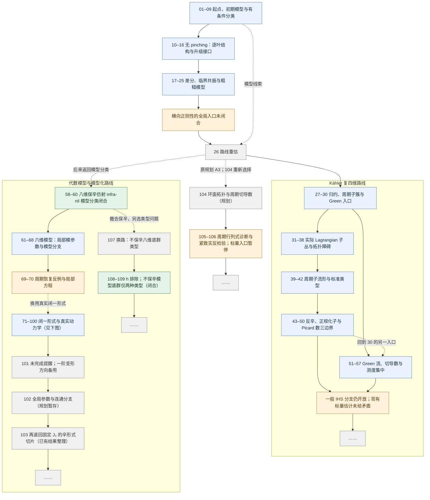
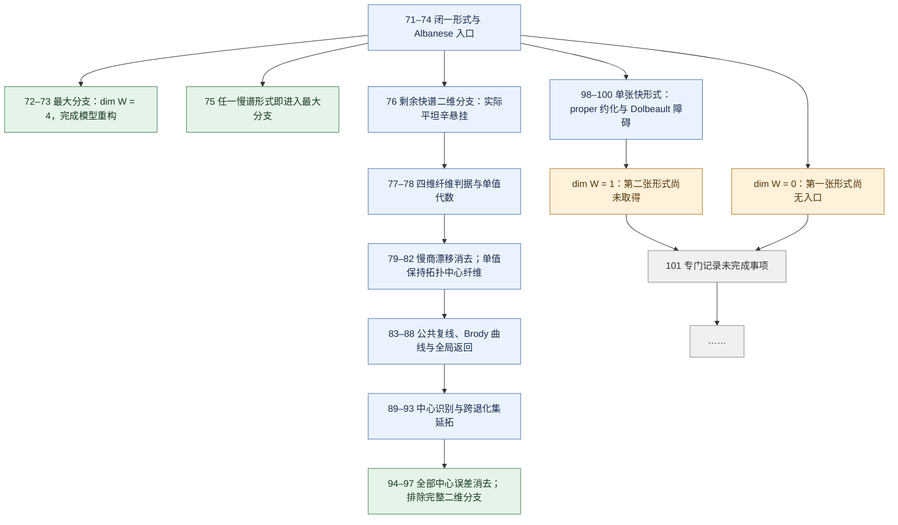

# 研究路线图

这是一份粗粒度导航，依据 README、笔记标题及已有阶段总结整理，不重复审查各篇证明。箭头表示研究上的转向或承接，不表示每个节点都是下一节点的严格证明前提；“已闭合”仅限所标注的特定问题，也不表示已独立复核或确认新颖性。

**读法：** 蓝色是研究内容，绿色是笔记中记录已闭合的特定分支，橙色是障碍或未解决问题，灰色是回顾与规划。未展开的后续统一写作“……”。下方编号可直接打开笔记。若阅读器不支持 Mermaid，仍可使用后面的分组索引。

## 总览：三条主要路线

## 模型化路线的后半段

这里的“一形式维数”指闭全纯一形式空间 W 的复维数；不是流形的复维数。以下分支结论只在笔记规定的模型拓扑、同伦与动力学范围内使用。

77–78 是纤维刚性与辅助代数的支线；83–93 包含反模型和失败接口，不应把范围内每篇笔记都当作主证明链的一步。98–100 的单形式约化也没有取得 76 的完整同纤维单值输入，不能直接套用二维分支的排除。

## 按方向打开笔记

分组尽量按主用途覆盖全部编号；跨方向复用以总览中的连线提示。具体结论及其限制仍以原笔记为准。

| 方向 / 阶段 | 笔记 |
| --- | --- |
| 起点与初期模型 | [01](notes/01_search_findings.md) · [02](notes/02_proof_roadmap.md) · [03](notes/03_next_session_tasks.md) · [04](notes/04_grassmann_Lp_regularization.md) · [05](notes/05_model_checks.md) · [06](notes/06_periodic_nonresonance_criterion.md) · [07](notes/07_bilipschitz_interface_audit.md) · [08](notes/08_symplectic_pinching_classification.md) · [09](notes/09_results_and_frontier.md) |
| 无 pinching 的横向正则性 | [10](notes/10_symplectic_without_pinching_reduction.md) · [11](notes/11_holomorphic_symplectic_resonance_tensors.md) · [12](notes/12_leafwise_affine_and_holomorphic_linearization.md) · [13](notes/13_continuous_generating_potentials_and_global_obstructions.md) · [14](notes/14_unpinched_symplectic_conjugacy_bootstrap.md) · [15](notes/15_finite_difference_normal_variations.md) · [16](notes/16_real_symplectic_leaf_polynomial_geometry.md) · [17](notes/17_secant_compactness_dichotomy.md) · [18](notes/18_high_order_escape_counterexample.md) · [19](notes/19_dini_holonomy_C1_criterion.md) · [20](notes/20_holomorphic_symplectic_failed_routes.md) · [21](notes/21_holomorphic_symplectic_entry_frontier.md) · [22](notes/22_exact_second_variation_graph_transform.md) · [23](notes/23_affine_unstable_slice_second_differences.md) · [24](notes/24_leafwise_weak_defect_and_summable_commutators.md) · [25](notes/25_critical_profiles_models_and_remaining_global_gap.md) |
| 第一次路线重估 | [26](notes/26_strategy_reassessment_after_transverse_obstruction.md) |
| Kähler 四维归约与入口 | [27](notes/27_Kahler_fourfold_reduction_and_projectivity.md) · [28](notes/28_continuous_Lagrangian_Chern_obstruction.md) · [29](notes/29_periodic_curves_and_natural_models.md) · [30](notes/30_Kahler_first_exploration_frontier.md) |
| 真实 Lagrangian 子丛与拓扑障碍 | [31](notes/31_twisted_index_Wu_and_determinant_parity.md) · [32](notes/32_K3_square_primary_obstructions_and_stable_realization.md) · [33](notes/33_fixed_lattice_data_and_unresolved_dynamical_input.md) · [34](notes/34_actual_Lagrangian_field_as_two_plane_in_rank_five.md) · [35](notes/35_compact_holomorphic_symplectic_cocycle_with_nonzero_stable_c1.md) · [36](notes/36_K3_square_actual_Lagrangian_existence_criterion.md) · [37](notes/37_Kummer_actual_Lagrangian_criterion_and_odd_Steenrod_square.md) · [38](notes/38_tangent_line_obstruction_finite_time_conformality_and_shadowing.md) |
| 周期子流形与标准变形类型 | [39](notes/39_finite_symmetry_excludes_all_Kummer_fourfolds.md) · [40](notes/40_pluricanonical_measure_and_periodic_submanifolds.md) · [41](notes/41_K3_square_rank_two_has_no_smooth_periodic_surfaces.md) · [42](notes/42_K3_square_surface_route_scope_and_difficulty.md) |
| 反辛推广、正规化子与边界例子 | [43](notes/43_remove_symplectic_and_projective_assumptions_from_41.md) · [44](notes/44_actual_antisymplectic_positive_entropy_rank_two_example.md) · [45](notes/45_antisymplectic_rank_two_excludes_all_Anosov.md) · [46](notes/46_cohomological_normalizer_and_signed_Chern_classes.md) · [47](notes/47_fixed_lattice_obstructions_in_arbitrary_Picard_rank_and_dimension_six.md) · [48](notes/48_actual_rank_three_examples_and_limit_of_the_fixed_class_method.md) · [49](notes/49_boundary_example_has_cyclic_normalizer_and_no_reverser.md) · [50](notes/50_boundary_example_periodic_geometry_and_remaining_dynamics.md) |
| Green 流、导数与测度集中 | [51](notes/51_Green_squares_Margulis_currents_and_leaf_measures.md) · [52](notes/52_leafwise_singularity_entropy_and_local_countermodel.md) · [53](notes/53_two_sided_metric_growth_and_Kahler_Green_axis.md) · [54](notes/54_global_derivative_tails_and_Green_measure_concentration.md) · [55](notes/55_critical_Jacobian_separation_and_its_Gibbs_origin.md) · [56](notes/56_compact_IHS_concentration_and_three_canonical_measures.md) · [57](notes/57_scope_failures_and_decision_after_the_concentration_tests.md) |
| 八维代数模型分类 | [58](notes/58_eight_dimensional_complex_symplectic_Anosov_nil_models.md) · [59](notes/59_nil_model_countertests_and_scope.md) · [60](notes/60_affine_infranil_models_and_automatic_invariance.md) |
| 六维模型的局部变形与模型分支 | [61](notes/61_six_dimensional_model_fixed_map_deformations.md) · [62](notes/62_six_dimensional_model_actual_local_normal_form.md) · [63](notes/63_model_deformation_cohomology_scope_and_countertests.md) · [64](notes/64_next_rounds_local_model_stability_plan.md) · [65](notes/65_arbitrary_step_nil_local_model_stability.md) · [66](notes/66_symplectic_periods_and_closedness_of_nil_models.md) · [67](notes/67_component_rigidity_and_finite_quotients.md) · [68](notes/68_progression_examples_countertests_and_status.md) |
| 周期恢复的反例与局部方程 | [69](notes/69_period_rank_lifting_counterexample.md) · [70](notes/70_local_cohomological_and_actual_period_branches.md) |
| 闭一形式、Albanese 与慢谱分支 | [71](notes/71_closed_one_forms_and_Albanese_reduction.md) · [72](notes/72_maximal_one_forms_force_principal_torus_bundle.md) · [73](notes/73_Albanese_model_exit_tests_and_remaining_gap.md) · [74](notes/74_closed_one_form_developing_map_has_no_critical_points.md) · [75](notes/75_a_single_slow_one_form_recovers_the_central_torus.md) |
| 快谱二维分支：悬挂与单值 | [76](notes/76_remaining_fast_Albanese_branch_and_countertests.md) · [77](notes/77_single_rate_toral_Anosov_one_form_rigidity.md) · [78](notes/78_toral_period_HLC_and_discrete_monodromy_obstruction.md) · [79](notes/79_note76_monodromy_derivative_growth_and_zero_rotation.md) · [80](notes/80_note76_finite_isotropic_directions_and_local_line.md) · [81](notes/81_note76_critical_cocycle_and_direction_countertests.md) · [82](notes/82_note76_central_cocycle_ellipticity_kills_slow_drift.md) |
| 公共复线、整曲线与全局返回 | [83](notes/83_constant_rank_stable_intersection_integrates_holomorphically.md) · [84](notes/84_every_central_fibre_contains_stable_and_unstable_entire_curves.md) · [85](notes/85_central_curve_results_countermodel_and_remaining_localization.md) · [86](notes/86_full_suspension_twisted_returns_and_separated_stable_parameters.md) · [87](notes/87_global_common_line_on_an_invariant_full_measure_open_set.md) · [88](notes/88_localization_stop_countertests_and_next_identification.md) |
| 中心识别、延拓与二维分支闭合 | [89](notes/89_central_sublinearity_and_common_leaf_slope_identity.md) · [90](notes/90_holomorphic_motion_gives_Fubini_for_the_common_line.md) · [91](notes/91_common_line_is_central_on_the_regular_open_set.md) · [92](notes/92_periodic_multiplier_test_allows_removable_rank_degeneracy.md) · [93](notes/93_common_central_line_extends_through_rank_degeneracy.md) · [94](notes/94_global_central_line_kills_the_opposite_central_error.md) · [95](notes/95_regular_central_fibres_are_complex_lagrangian_surfaces.md) · [96](notes/96_transverse_join_recovers_both_central_lines_and_all_fibres.md) · [97](notes/97_maximal_continuous_lagrangian_family_eliminates_fast_Albanese_branch.md) |
| 单张快形式与 Dolbeault 障碍 | [98](notes/98_single_fast_form_flux_and_exact_flow_normal_form.md) · [99](notes/99_single_fast_form_proper_holomorphic_reduction.md) · [100](notes/100_single_fast_form_forces_a_fast_Dolbeault_torsor_class.md) |
| 未完成提醒与备用方向 | [101](notes/101_unfinished_one_form_branch_and_retreat_to_the_reduction_family.md) |
| 进一步回退：全局模型参数 | [102](notes/102_larger_retreat_to_global_fixed_model_parameter_components.md) |

| 再退回固定复结构的形式切片 | [103](notes/103_retreat_to_the_fixed_complex_structure_symplectic_slice.md) |

| 返回未系统展开的 A3 环面拓扑方向 | [104](notes/104_return_to_unexplored_toral_topology_route_A3.md) |

| A3 首轮检验：标量障碍与方法边界 | [105](notes/105_toral_periodic_Jacobian_is_exactly_the_SRB_entropy_obstruction.md) · [106](notes/106_compact_analytic_toral_countertest_to_scalar_periodic_rigidity.md) |

| 换路比较与不保辛八维模型候选 | [107](notes/107_alternative_routes_after_the_scalar_toral_stop.md) |

| 不保辛八维模型：h 排除与类型分类闭合 | [108](notes/108_tensor_bracket_center_lemma_excludes_h_without_symplecticity.md) · [109](notes/109_eight_dimensional_holomorphic_nil_model_types_without_symplecticity.md) |

本图只作导航，没有新增数学结论，也没有展开各分支的下一步任务。
